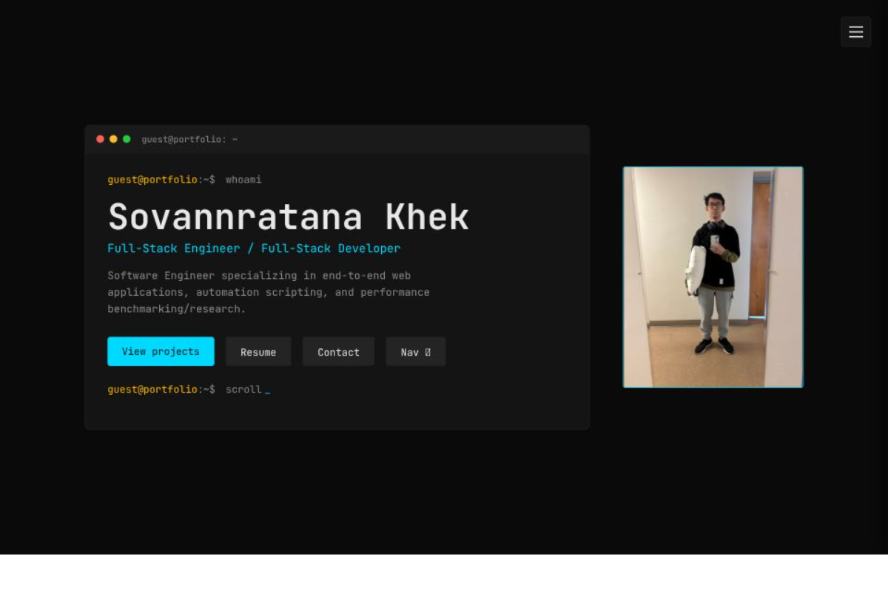

# Ratana Khek | Portfolio

A console-themed developer portfolio. Instead of a static list of projects, each one runs as a scripted demo inside an on-page terminal, with interactive previews embedded in the output.

**Live site:** https://ratana-portfolio.vercel.app/



## Overview

The site is a single page that mixes a traditional portfolio (about, experience, education, contact) with one distinctive element: a console. Picking a project types out a short session in the terminal, then opens a preview built for that project. The console is one section of the site, not the whole interface, so a visitor can skim it like any other portfolio.

## Features

- **Projects:** a scrollable grid of terminal-style cards. Clicking a card runs that project's script in the console, and clicking a tech tag jumps to that skill.
- **Console:** commands are typed out character by character, followed by output lines and embedded previews:
  - a benchmark table and research paper preview for HNSW insertion research
  - a pipeline diagram, worked example and demo video for a Huffman + Hamming error-correction pipeline
  - a playable digital lock, ported from Python to JavaScript, with an in-browser break-in simulation
  - a feature breakdown and recorded demo for a hackathon AI coach
- **Skills:** grouped skill pills with a terminal-style detail panel. The "used in" project links are derived from each project's tech list, so they can't drift out of date.
- **Education:** a `git log`-style timeline of milestones.
- **Experience:** a `ps aux`-style process list with expandable rows.
- **Navigation:** a slide-in menu with scroll-spy that highlights the current section.
- **Contact:** a working message form (Web3Forms) with browser autofill and a honeypot field to filter bots, plus links to email, GitHub, LinkedIn and a resume download.

## Tech stack

| Area | Choice |
| --- | --- |
| Framework | React with Vite |
| Styling | CSS Modules and CSS custom properties (no UI library) |
| State | React Context, composed from small custom hooks |
| Fonts | JetBrains Mono and Inter |
| Contact form | Web3Forms (static-site friendly, no backend) |

## How it's organized

The site is data-driven. Content lives in plain data files and components render it.

- `data/projects.jsx` holds every project: title, blurb, tech list, and the `script` for its console demo. Each project owns its script, so there is no second file to keep in sync.
- `data/skills.js` holds skill names, categories and blurbs. Which projects use a skill is computed from the projects' `tech` arrays and never stored twice.
- `data/education.js` and `data/experience.js` feed the timeline and the process list.
- `context/PortfolioProvider.jsx` is a single provider that composes `useConsoleState`, `useSkillsState` and `useNavState`. Components that share state (the project cards, the console, the skills panel and the nav) read from it.

A console script is an array of steps:

```js
script: [
  { type: 'command', text: 'cd Projects/example' },
  { type: 'output',  text: 'Some output line' },
  { type: 'element', content: <ExamplePreview /> },
  { type: 'action',  run: () => window.open('...', '_blank') },
]
```

## Running locally

```bash
npm install
npm run dev
```

The contact form needs a Web3Forms access key. Create a `.env` file in the project root:

```
VITE_WEB3FORMS_KEY=your-access-key
```

Restart the dev server after creating or changing `.env`. To build for production, run `npm run build`, and set the same variable in your hosting provider's environment settings.

## Design decisions

- **Hybrid, not all-console.** A fully terminal site is fun but slow to skim, so the console is one section and the rest is conventional.
- **Curated over exhaustive.** The site shows a handful of well-documented projects. The full set lives on GitHub.
- **Single source of truth.** Anything derivable (such as skill-to-project links) is computed, not duplicated.
- **Real data in previews.** The example outputs shown in project previews come from actually running the code, not from invented numbers.

## Notes

- The hackathon project (Oracle Lens) no longer runs because its Riot API and AWS Bedrock access expired. The site preserves it with a recorded demo and links to the original source and Devpost page.

## Contact

Ratana Khek · [GitHub](https://github.com/ratanakhek22) · [LinkedIn](https://www.linkedin.com/in/skhek/)